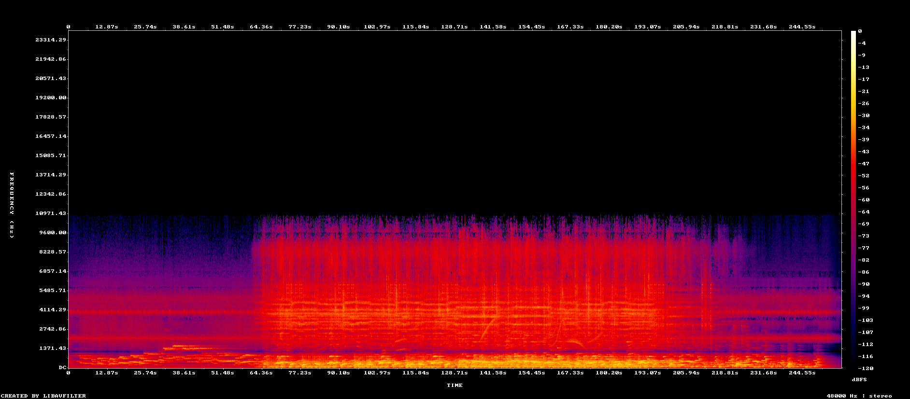
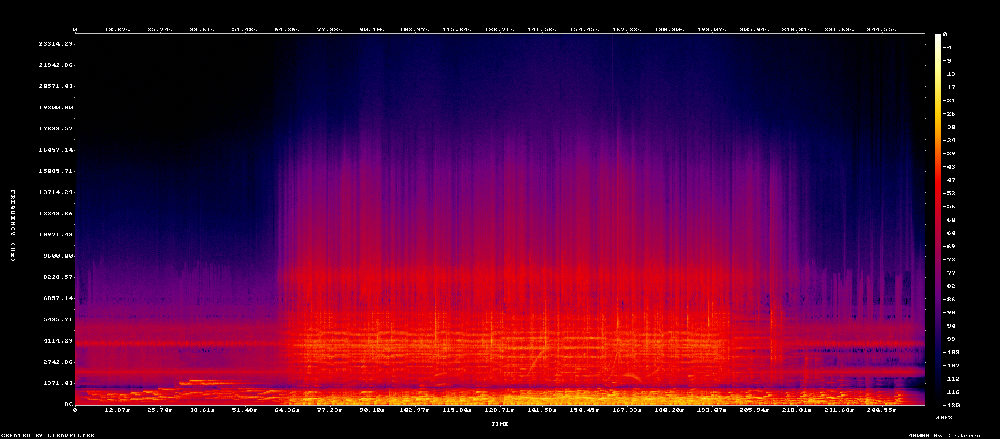
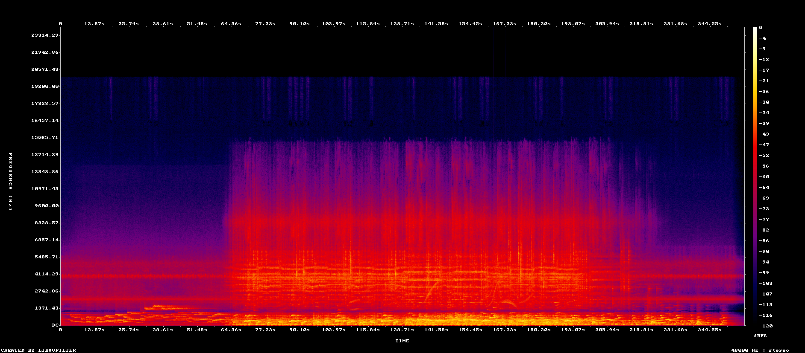

# airfill

airfill puts back the highs that a lossy codec cut off. An MP3 at 128 kbps or lower usually has
nothing above 15-16 kHz, and at 64 kbps nothing above 11 kHz. airfill finds that cut in every
frame, fills the band above it from the music just under it, and writes a 16-bit FLAC.

There is no neural network and no training data. It is plain signal processing in the
spirit of SBR (the trick HE-AAC uses), but done after decoding, with no side information
from the encoder.

It does not recover what the codec threw away. It makes up highs that fit the music:
how loud the band under the cut is, how it moves in time, how wide its stereo is.

"A2 - Everyday Things" by The Patients (album *Milwaukee Protocol*), encoded to MP3 at 64 kbps:



The same MP3 after airfill:



The release it was encoded from. It was itself made from an MP3 and stops at 15 kHz, so here
airfill goes higher than the original does:



## Install

You need [Rust](https://rustup.rs) and [ffmpeg](https://ffmpeg.org) (airfill calls ffmpeg to
read and write audio, so it must be on the path).

```
git clone https://github.com/LicaRedMoth/airfill
cd airfill
cargo install --path .
```

This puts `airfill` where cargo keeps its programs (`~/.cargo/bin`).

## Use

```
airfill input.mp3 output.flac
```

Any file ffmpeg reads works as input. The output has the tags of the input (and its cover, for
FLAC), its sample rate (at least 44.1 kHz) and its channels: mono stays mono, more than two
channels are mixed down to stereo. In a terminal a bar shows the progress; a minute of audio takes
about 12 s on a slow laptop.

A file with no codec cut (a real lossless file) comes out as it went in: airfill finds no cut
and adds nothing.

### Output format

The extension picks the container: `.flac` or `.wav`. Without options the output is 16-bit
FLAC at compression level 0 (fast to write, a little larger).

```
airfill input.mp3 output.flac --bits 24 --flac-level 8
airfill input.mp3 output.wav --bits 32f
```

- `--bits 16`, `24` or `32f`: 16-bit and 24-bit get TPDF dither, `32f` is 32-bit float and only
  goes in a WAV.
- `--flac-level 0` to `12`: only the size and the time to write change, never the sound.
- `--rate HZ` resamples the output, and `--top HZ` sets how high the fill reaches. Without
  `--top` the fill goes up to 20 kHz at 44.1 kHz, and to the top of the band at 48 kHz and up.
  So a file that stops at its own ceiling gets extended too: a 48 kHz file ends at 24 kHz,
  and with `--rate 96000` airfill treats 24 kHz as the cut and fills up to 48 kHz.
  Everything was tuned and measured up to 20 kHz; above it, trust your ears.

### Level

Some MP3s decode to more than 0 dBFS, and a 16- or 24-bit file would clip those peaks. airfill
then lowers the whole track just enough for its peak to sit at -0.3 dBFS, and says so:

```
lowered by 1.42 dB so the file does not clip
```

With `--gain` the level is yours: `--gain 0` keeps it as it is, even if it clips. A 32-bit float
WAV can not clip, so it is never lowered.

### How the fill sounds

| Option | Default | What it does |
|---|---|---|
| `--tilt DB` | 0 | Extra slope of the fill, dB per octave: negative is darker, 0 adds none |
| `--fill-width DB` | 0 | Side of the fill up or down by this many dB, power kept; 0 leaves it |
| `--side-min X` | 0.6 | Fill the side from its own cut when the codec cut it lower than the mid, but only when that cut is above this share of the mid cut; 1 turns it off |
| `--texture X` | 0 | How much fine structure of the band under the cut the fill copies, 0 (smooth) to 1 |
| `--holes DB` | 15 | Noise into spectral holes under the cut deeper than this; 0 turns it off |
| `--follow X` | 0.7 | How much the fill follows level changes under the cut, 0 to 1 |
| `--fall DB` | 80 | For cuts under 15 kHz the fill falls by at most this many dB per second; 0 is no limit |

A 0 here is a plain value, not "let airfill decide": `--tilt 0` adds no slope, `--holes 0`
fills no holes. Only `--gain` and `--rate` decide for themselves when left out. The defaults
were tuned on half of the benchmark corpus and by ear on full tracks.

## How it works

1. In every STFT frame (2048 points, hop 512) the cut is the sharpest drop above 8 kHz. In
   quiet passages an encoder lowers its cut, so the search follows it down. A frame with no
   cut is left alone.
2. Under the cut airfill fits a slope to the spectrum, smoothed over 10 s, and takes a level
   from the band there. That gives a line, and above the cut the line bends down the way the
   highs of real recordings do. Above about 1.4 times the cut the line comes from a 60 s
   window, so the made-up top keeps its level but does not swing with the music.
3. Power goes in only where the decoded signal is under the line, smooth across frequency.
   Phases come from the band under the cut, shifted up. Copying its fine structure as well
   (`--texture`) turned the harmonics of a voice into grain above the cut, so by default it
   is off, and the fill is raised 0.7 dB to make up for the level that cost.
4. The fill follows level changes under the cut only part of the way. For low cuts it falls
   slowly after loud moments, so it does not pump with every syllable of a voice.
5. MP3 in joint stereo codes the mid (left plus right) and the side (left minus right) apart,
   and gives the side fewer bits, so the side is often cut lower and with a ragged edge. airfill
   finds the side cut on its own and fills the side from there up to the mid cut, 3 dB under
   its line, fading in from 80% of the side cut. A side cut under 60% of the mid cut is taken
   for a nearly mono mix, not the codec, and left alone.
6. Low bitrates also leave empty patches under the cut. Those get quiet noise at the level of
   their surroundings.

Long tracks go in blocks of 60 s with 15 s of context on each side, so memory stays about
the same for any length.

## Results

The benchmark encodes lossless excerpts (40 s, one track per artist, from a personal library)
with LAME at constant bitrate, decodes them, and compares each version with the original.
Phase is never compared, since made-up highs can not match the original waveform. All the
measures look at magnitudes in dB.

In short: above the cut, the MP3 is 21 to 25 dB quieter than the original on average, and
after airfill 4 to 8 dB. Its highs also rise and fall with the music (`env_corr` from about
0.2 to 0.6-0.7), and the step at the cut nearly goes away.

The numbers below are from the 12 held-out excerpts that were not used for tuning, run with
the code in this repository. Medians:

| Measure | 128k MP3 | 128k airfill | 96k MP3 | 96k airfill | 64k MP3 | 64k airfill |
|---|---|---|---|---|---|---|
| `env_err`, dB (lower is better) | 35.5 | 6.2 | 35.9 | 8.8 | 41.5 | 14.4 |
| `env_corr` (higher is better) | 0.26 | 0.71 | 0.24 | 0.65 | 0.15 | 0.58 |
| `bias`, dB (0 is best) | -20.9 | -3.7 | -22.2 | -5.1 | -25.1 | -7.9 |
| `seam`, dB (0 is best) | -15.0 | -2.1 | -21.3 | -0.8 | -32.1 | -1.5 |
| `lsd_hf`, dB (lower is better) | 12.0 | 8.2 | 13.5 | 9.5 | 15.7 | 11.7 |
| `lsd_lf`, dB (lower is better) | 5.08 | 4.94 | 6.28 | 5.69 | 7.80 | 6.61 |
| `stereo` (lower is better) | 0.38 | 0.19 | 0.28 | 0.15 | 0.45 | 0.22 |
| `width_jit`, dB (lower is better) | 3.5 | 1.6 | 7.8 | 2.7 | 19.5 | 5.8 |

- `env_err`: error of the band levels above the cut over time. How far the highs are from
  the original's, moment by moment.
- `env_corr`: do those levels rise and fall together with the original.
- `bias`: mean level above the cut; negative is darker than the original.
- `seam`: the step at the cut; negative is a dull edge, positive a fill that starts too loud.
- `lsd_hf`: log-spectral distance above the cut, per frame (the usual measure for
  bandwidth extension). It punishes any wrong detail, so it moves less than the others.
- `lsd_lf`: the same from 1 kHz to the cut, where the codec kept the music. airfill must
  not make it worse; it gets better because the holes and the side under the mid cut are filled.
- `stereo`: error of the left-right correlation above the cut.
- `width_jit`: how much the stereo width flickers in time under the cut.

## Limits

- Only LAME MP3 at constant bitrate was measured. AAC, Opus and Vorbis cut their highs the same
  way and airfill treats them the same, but no numbers were taken for them.
- airfill can not tell a codec cut from a recording that has no highs of its own (an old tape,
  a sample from a band-limited source). It fills both.
- Stereo the codec destroyed far under its cut stays destroyed. Low bitrates can turn the
  highs of a mix into mono there, and airfill can only take the width from what is left.
- In some material the fill copies codec noise from under the cut and makes it louder.
- The defaults were tuned on music. Speech was only checked on a few test recordings, where
  the fill came out a little closer to the original once `--texture` was off.
- It works on whole files: it looks up to 10 s ahead, so it can not run in real time.

## Speed

On a two-core laptop CPU (Intel Pentium B960) an 8.5 minute track at 48 kHz takes about
2.5 minutes, a quarter of its length.

## Testing

- `cargo test`: the filters and the STFT are checked against values from scipy, and the fast
  filters against a plain version of themselves.
- The unit tests pass under [Miri](https://github.com/rust-lang/miri), all but the two largest
  filter windows, which would take hours there and run in `cargo test`.
- A full track ran clean under AddressSanitizer.
- `fuzz/` has a [cargo-fuzz](https://github.com/rust-fuzz/cargo-fuzz) target that feeds the
  engine any bytes as audio at 8 to 96 kHz. It must not panic, must keep the length, and must
  give finite output for finite input. Two runs, of 6 and 3 hours (about 30 000 inputs), found
  nothing. `fuzz/make_seeds.sh` makes the starting inputs.

```
cargo +nightly miri test
fuzz/make_seeds.sh
cargo +nightly fuzz run engine fuzz/corpus/engine -- -max_len=600000 -rss_limit_mb=3000
```

## Benchmark

`bench/` has the benchmark in Python (numpy, scipy, soundfile; LAME and ffmpeg on the path).
The music is not included, so it builds a corpus from your own library of lossless files:

```
cd bench
python3 scan_sources.py ~/Music > scan.csv     # which FLACs are really full band
python3 make_corpus.py ~/Music                 # excerpts, MP3s, dev/test split
python3 run_bench.py --split dev               # results.csv and a summary
python3 exam.py original.flac out/ --kbps 64   # one full track, judged per minute
```

Besides the measures in the table, the summary has `lsd_edge` (log-spectral distance in the
codec roll-off, 70-100% of the cut), `stereo_lf` and `width_lf` (error of the left-right
correlation and of the side-to-mid level from 1.5 kHz to the cut) and `width_med` (median of
the side-to-mid error under the cut; negative is narrower than the original).

`make_corpus.py` takes one track per artist and expects album folders named `Artist_Album`.
Excerpts that already have a cut of their own are skipped. Set `AIRFILL` to use another
binary, and `AIRFILL_ARGS` to pass options to it. The scripts talk to the binary with
`airfill --raw --rate HZ`, which reads stereo f32le from stdin and writes it to stdout.

## License

MIT, see [LICENSE](LICENSE).
